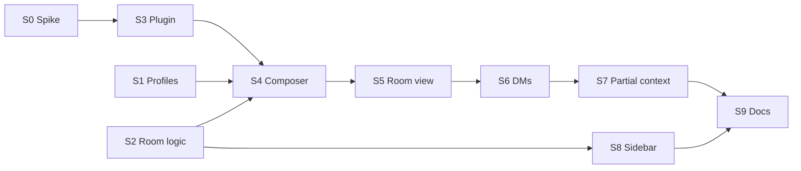

# Multi-agent chat: implementation plan

Each step below is one delegated task. Give an agent: "Read `AGENTS.md` and `doc/multi-agent-chat.md` (Decisions,
Contract and step Sn). Implement step Sn only." Steps list the files they own; the AGENTS.md rules (feature folders,
one block per shared file, `npm run check`) apply to all of them. When a step finishes, append a line to **Log** at the
end of this file: what changed, anything later steps must know.

## Decisions (settled, don't re-open in a step)

- **Room**: a group chat of N ordinary Paseo agents in one workspace plus the user. Each agent keeps its own provider
  session; "talking" means the router delivers a message into an agent's session as a user turn.
- **Room id = the lead's agent id** (the first agent). Membership lives in agent labels (Contract). No other storage.
- A chat turns into a room the first time the user mentions an agent that isn't in it. Without mentions nothing
  changes and no plugin is needed.
- **Profiles** are the daemon's `agentProfiles` config (protocol `AgentProfileSchema`: id, name, icon, color, provider,
  model, modeId, thinkingOptionId, featureValues, notes). Paseo desktop and agents' `list_profiles` tool read the same
  list. `notes` doubles as the agent's role in a room (sent with its first delivery; profiles have no system prompt).
- **`@agent`** is the default agent: Settings → Default agent, else the composer's picks (`loadDraft` in
  `Composer.tsx`). Always available, also with zero profiles.
- **Recipients of a user message**: the mentioned members; **no mention = every member**. In a one-agent chat that's the
  one agent, as today; a new chat needs no mention.
- **Recipients of an agent message**: the members it mentions. No mention = addressed to the user only; the exchange
  stops there.
- **Shared context**: a delivery carries a digest of the room posts the member hasn't seen since its last turn, so
  members catch up when addressed instead of every post waking everyone.
- **DM**: a user message sent with the lock on goes only to the mentioned members (lock needs a mention). The reply is
  private: not routed, its mentions ignored, never in other members' digests or shared context. It's a conversation
  filter, not a security boundary (shared filesystem; paseo MCP tools can read other sessions).
- **Joining**: a mention of a non-member adds a joining chip in the composer with Model, Thinking and Context picks.
  Context: None / From here (a picked message onward) / Whole room / Fork @x (x's full session up to a message). A member
  never sees room posts from before it joined except what was shared.
- **Routing runs in a new daemon plugin `mypaseo-rooms`** (`rooms-plugin/`), installed apart from `mypaseo-git`: it
  works with the browser closed, and two open tabs can't double-forward.
- **Loop guard**: at most 6 agent-triggered deliveries per user post; then the room pauses with a Continue button.
- Out of scope: agent→agent DMs, a worktree per member, cross-host rooms.

## Contract (shared by the steps; change it only here, then tell the affected steps)

### Labels (on agents)

| Label | Value |
|---|---|
| `mypaseo.room` | room id = lead agent id (the lead carries its own id) |
| `mypaseo.handle` | handle without `@` |
| `mypaseo.profile` | profile id; absent for `@agent`. Set on any agent created from a profile, room or not |

Members of room R = the host's non-archived agents with `labels['mypaseo.room'] === R`.

### Handles and mentions

- `slug(name)`: lowercase, every run of characters outside `[a-z0-9]` becomes `-`, trim `-`.
- Reserved: `agent` (default agent), `user`. Settings rejects a profile whose slug is reserved, empty or taken by
  another profile.
- Unique within a room: a taken handle gets `-2`, `-3`, …
- A mention is `@handle` of a known handle, case-insensitive, where the `@` is at the start or after a character that
  is not a letter, digit, `_`, `.`, `/`, `-` or `@`, and the handle isn't followed by `[a-z0-9-]`. Text inside fenced
  code blocks and inline code doesn't count.
- The parser exists twice (plugin and `src/`, which can't import each other, like `git.ts` mirrors plugin types). Both
  must pass these cases (handles `agent`, `code-reviewer`, `code-reviewer-2`):

| Text | Mentions |
|---|---|
| `@agent fix it` | agent |
| `ask @Code-Reviewer, then @agent.` | code-reviewer, agent |
| `@code-reviewer-2 too` | code-reviewer-2 |
| `@agentic` | — |
| `mail bob@agent.com` | — |
| `` `@agent` `` and a fenced block containing `@agent` | — |
| `npm i @types/react` | — |
| `(@agent)` | agent |

### Plugin `mypaseo-rooms`

RPCs (zod schemas in `rooms-plugin/index.server.ts` are the source of truth; `src/rooms.ts` mirrors the types):

```ts
type MemberConfig = { provider: string; model?: string; thinkingOptionId?: string; modeId?: string; featureValues?: Record<string, unknown>; systemPrompt?: string }
type TextAttachment = { type: 'text'; mimeType: 'text/plain'; title?: string; text: string; contextKind?: string }
type Context =
  | { kind: 'none' }
  | { kind: 'range'; from: string; to?: string } // ISO timestamps of room items, inclusive
  | { kind: 'all' }
  | { kind: 'attachment'; attachment: TextAttachment } // e.g. the client's buildAgentForkContext result
type Member = { handle: string; profileId?: string; notes?: string; config: MemberConfig; context: Context }

'room.join':     { roomId: string; members: Member[] } -> { agentIds: string[] } // creates idle agents in the lead's workspace with the labels; context and notes go with each one's first delivery
'room.post':     { roomId: string; text: string; to: string[] /* handles; [] = every member */; dm: boolean; images?: { data: string; mimeType: string }[]; attachments?: unknown[] } -> { postId: string }
'room.stop':     { roomId: string } -> {} // drops queued and held deliveries; the client cancels running members itself (the plugin API has no cancel)
'room.continue': { roomId: string } -> {} // after a pause: resets the loop guard, delivers what was held
'room.log':      { roomId: string; after?: string /* ISO */ } -> { items: { id: string; kind: string; data: unknown; timestamp: string }[] } // the room items (below) from the room log, oldest first
```

The client labels the lead (`daemon.updateAgent(leadId, { labels })`) before its first `room.join`: the plugin API
can't update labels.

### Deliveries

- Sent with `messageId` `mpr:<id>` (public) or `mpr-dm:<id>` (DM), and the text's last line is the marker
  `⟦mpr:<id> <ISO time>⟧` / `⟦mpr-dm:<id> <ISO time>⟧`. `deliveryOf` reads the marker (`{ dm, at }`), not the
  `messageId`: when the daemon rebuilds a timeline from the provider's history (daemon restart, Refresh, rewind), every
  `messageId` becomes the provider's, every entry gets the rebuild time as its timestamp, and text attachments are
  prepended to the text. The marker's time stands in for the lost timestamps of its turn. The view hides every
  `user_message` with a marker; a turn opened by an `mpr-dm:` delivery is private.
- Delivery text, in order: a room line (your handle, the other members with provider/model, the rules: mention to hand
  off, no mention = to the user, your final message is posted); the role (`notes`, first delivery only, and only for a
  member created without a `systemPrompt`, which carries it otherwise); the shared context (first delivery only, as an
  attachment); the digest; the new message(s) with author and recipients (`user → everyone`, `@agent → @code-reviewer`,
  `user → you (direct)`); the marker.
- Busy target: queue; at its `agent.turn_ended`, deliver the queued public messages as one turn. DM deliveries go one
  per turn, never batched with public ones.

### Room posts (what digests, shared context and the view are made of)

- A user post: a `room.post` room item (below) with `dm: false`.
- An agent post: in a member's timeline, the last `assistant_message` of a turn opened by an `mpr:` delivery (the turn
  runs until the next `user_message`), if the turn completed.
- Turns opened by `mpr-dm:` deliveries or by messages typed in a member's own chat are not room posts.
- Digest for member M: room posts after `max(M joined, M's last delivery)`, not by M, excluding the message being
  delivered; at most 20, each cut to 2000 characters with `… (truncated)`.

### Room items (plugin timeline items on the lead, `pluginId: 'mypaseo-rooms'`, `version: 1`)

| kind | data |
|---|---|
| `room.post` | `{ id, text, to: string[], dm: boolean, images: number, files: string[] }` |
| `room.join` | `{ handles: string[], context: string }` (context: a short human summary, e.g. "from 14:02") |
| `room.leave` | `{ handle }` (on `agent.archived` of a member) |
| `room.paused` | `{ held: number }` |
| `room.resumed` | `{}` (the pause ended: Continue, or Stop or a new user post, which drop what was held) |

Each item is appended to the lead's timeline with an `id` (the daemon rejects an append without one) and also written
to the room log (plugin memory plus a JSON file per room): a rebuilt timeline drops plugin items. The view loads
`room.log` when the room opens, after a `replacement` and whenever a `mypaseo-rooms` item streams in on the lead, and
shows the log's copies only (their times are the plugin's; the streamed copy is stamped a few ms later).

## Steps and order



Parallel waves: {S0, S1, S2} → {S3, S8} → S4 → S5 → S6 → S7 → S9. S4–S7 all edit `features/chat/`, so they run one
after another.

---

### S0 Spike: verify the platform assumptions

Needs a live daemon and a ready provider (use the cheapest model). Build a throwaway plugin `mypaseo-rooms-spike` in
`/tmp` (not committed), install it with `npx paseo plugin install <dir>`, remove it when done. Answer each with
evidence and append the answers to **Log**:

1. A1: `server.on('agent.turn_ended')` fires for agents the browser created; does `event.timeline` hold the turn's
   items or the whole timeline; is the final `assistant_message` in it?
2. A2: from a hook, `paseo.agents.ref(id).send(text, { messageId: 'mpr:x' })` starts a turn, and the `user_message` in
   `fetchAgentTimeline` carries `messageId: 'mpr:x'`.
3. A3: `ref(id).timeline.append({ type: 'plugin', kind: 'room.post', version: 1, data })` reaches the browser's
   `subscribeAgentTimeline` and `fetchAgentTimeline`, and the provider does not see it (ask the agent).
4. A4: `paseo.agents.create({ config, cwd, labels })` without a prompt makes an idle agent; the labels appear in the
   browser's agent snapshots (`agent.labels`). Can it take a `workspaceId`?
5. A5: `daemon.updateAgent(id, { labels })` merges with or replaces the existing labels.
6. A6: `buildAgentForkContext(id, { boundaryMessageId })`: is the boundary message included; which items have a
   `messageId`?
7. A7: do streamed timeline events carry a timestamp, or only fetched entries?
8. A8: can `paseo.agents.list()` filter by label?

Fallbacks, to record in the Contract if needed: A2 fails → the delivery text starts with a marker line
`⟦mpr:<id>⟧` / `⟦mpr-dm:<id>⟧` that the view strips (only `deliveryOf` in S2 and the plugin's encoder change). A3 fails
→ the plugin keeps the room log in memory plus a JSON file and adds `room.log({ roomId, after })`, polled by the
client. A5 replaces → the client merges before calling. A7 no → the client stamps streamed items on arrival.

Done when: every question has an answer in **Log**; the spike plugin is removed.

### S1 Profiles: Settings section and store

Owns `features/settings/ProfilesSection.tsx` (new), `features/settings/settings.css` (its block). Touches, one block
each: `Settings.tsx` (register the section), `store.ts`, `daemon.ts`.

- `daemon.ts`: `export type AgentProfile = NonNullable<DaemonConfig['agentProfiles']>[number]`.
- `store.ts`: `profiles: AgentProfile[]` in `HostState`, loaded with `getDaemonConfig()` next to projects/providers on
  connect; export `setProfiles(hostId, profiles)`.
- Section "Profiles": list (provider icon, name, `@handle`, model · thinking); add, edit, delete. Fields: name,
  provider (ready ones), model, thinking, mode, notes (textarea, labelled as the role for group chats). Validates the
  handle rules from the Contract. Saves the whole list with `patch({ agentProfiles })`, then `setProfiles`. New ids:
  `crypto.randomUUID()`.
- UI copy per `doc/action-labels.md`, icons per `doc/action-grid.md`.

Done when: `npm run check` passes; a profile made here shows in Paseo desktop and survives a reload; duplicate or
reserved names are refused.

### S2 Room logic (pure modules)

Owns `features/rooms/` (new): `handles.ts`, `mentions.ts`, `members.ts`, `roomView.ts`, tests for each. No React, no
UI.

- `handles.ts`: `slug`, `RESERVED`, `uniqueHandle(base, taken)`.
- `mentions.ts`: `mentions(text, handles): string[]` (unique, first-seen order) — must pass the Contract's table.
- `members.ts`: `roomId(agent)`, `roomMembers(agents, roomId)`, `handleOf(agent, profiles)` (label, else profile slug,
  else `agent`), `isLead(agent)`.
- `roomView.ts`: `deliveryOf(item): { dm: boolean } | null` (the one place that knows the `mpr` encoding), and
  `mergeRoom(members: { agentId; handle; entries: { item; timestamp }[] }[], leadId)` → `RoomItem[]`
  (`{ item, timestamp, author: handle | 'user', agentId, private: boolean, key }`), sorted by timestamp, ties keep each
  agent's order. It drops deliveries, keeps the lead's `mypaseo-rooms` plugin items, marks private turns, keeps
  messages typed in a member's own chat (author `user`, sent to that member).

Done when: `npm run check` passes; tests cover the mention table, `uniqueHandle`, and a merged two-agent fixture with
a DM turn.

### S3 Plugin `mypaseo-rooms` and its client

Depends on S0. Owns `rooms-plugin/` (new: `paseo-plugin.json`, `index.server.ts`, `route.ts`, `route.test.ts`) and
`src/rooms.ts` (new). Touches, one block each: `.oxlintrc.json` (allow `invokePluginRpc` in `src/rooms.ts`, message
naming both clients), `.dependency-cruiser.cjs` (`plugin-apart` covers `rooms-plugin/`), `.jscpd.json` (path),
`knip.jsonc` (entry), `package.json` (`test` and `check` also run `rooms-plugin/**/*.test.ts`).

- `route.ts` is pure: mentions (the Contract's table again), recipients, digest, delivery text, the loop guard, queue
  batching. `index.server.ts` wires RPCs, the `agent.turn_ended` and `agent.archived` hooks and in-memory state
  (queues, loop counters, pending join contexts; lost on daemon restart — say so in a `shortcut:` comment).
- Implements the Contract exactly: RPCs, labels, deliveries, room posts, room items.
- `src/rooms.ts`: typed wrappers for the four RPCs, mirrored types, `ROOM_LABELS` keys. A missing plugin rejects; the
  caller shows "Multi-agent chat needs the mypaseo-rooms daemon plugin, see the README".

Done when: `npm run check` passes; `route.test.ts` covers routing, DM no-routing, batching, the loop guard and digest
caps; manually, with `npx paseo plugin install ./rooms-plugin`: two agents told to mention each other stop after 6
hops with a `room.paused` item, and Continue resumes.

### S4 Composer: mentions, joining, sending to a room

Depends on S1, S2, S3. Owns `features/chat/Composer.tsx`, `autocomplete.ts`, `useAutocomplete.tsx`, `composer.css`;
`features/rooms/JoinChip.tsx` (new). Touches, one block: `.dependency-cruiser.cjs` (`chat: ['review', 'rooms']`).

- `@` popup: members first, then profiles and `@agent`, then files. An agent pick inserts `@handle ` (no quotes).
- Each mentioned non-member gets a `JoinChip` above the textarea: provider icon, `@handle`, Model and Thinking `Pick`s
  (defaults from the profile, or `loadDraft()` for `@agent`), remove. Cycle Thinking acts on the chip whose mention
  holds the caret. Context: only "None" in this step (S7 adds the rest).
- Send:
  - no room, no new members → unchanged (`sendAgentMessage`).
  - no room, new members → label the lead (`mypaseo.room`/`mypaseo.handle` from `handleOf`), `room.join`, `room.post`.
  - room → `room.join` for new members if any, then `room.post` with `to` = the mentioned handles.
  - new chat: no mention → unchanged; one mention → today's flow with that profile's config and the `mypaseo.profile`
    label; two or more → create the first as lead without a prompt, then join the rest and post.
- Placeholder: "Message the agent…" with one member, "Message everyone…" in a room.
- Stop in a room: `cancelAgent` on every running member, then `room.stop`.

Done when: `npm run check` passes; manually: mentioning a profile in a single chat creates the member with the picked
thinking level; a message without a mention reaches every member; mentioning one reaches only it.

### S5 Room view

Depends on S4. Owns `features/chat/Chat.tsx`, `Timeline.tsx`, `WorkGroup.tsx`, `work.ts`, `useRoomTimeline.ts` (new),
`chat.css`; `features/rooms/MemberBar.tsx` (new).

- Chat of an agent with `mypaseo.room` shows the room: `useRoomTimeline(members)` subscribes to each member (shape of
  `useTimeline`, entries with timestamps) and returns `mergeRoom(...)`.
- Each message shows its author (provider icon + `@handle`); work groups split by author. Renders the room items:
  `room.post` as the user's message with recipients, `room.join`/`room.leave` as a muted line, `room.paused` with a
  Continue button (`room.continue`).
- Pending permissions of every member, labelled by handle. `MemberBar` at the top: per member status, Model and
  Thinking picks (`setAgentModel`, `setAgentThinkingOption`), Remove (archive, confirm).
- Keeps the line markup contract in AGENTS.md (`[data-item]`, `.timeline`): Rail, artifacts and scrolling must work.

Done when: `npm run check` passes; manually: a 3-member room reads as one conversation in time order; deliveries
aren't shown; permissions from a non-lead member can be answered in the room.

### S6 Direct messages

Depends on S5. Owns the same chat files plus `features/rooms/` as needed.

- Composer lock toggle, enabled only with at least one mention; sends `room.post` with `dm: true`.
- View: DM posts and private replies carry a lock badge ("@bob · direct").

Done when: `npm run check` passes; manually: after a DM to one member and its reply, a public message to another member
shows a digest without the DM or the reply (check that member's own chat).

### S7 Partial context when adding an agent

Depends on S6. Owns the chat files, `features/rooms/JoinChip.tsx`.

- Message action "Share From Here" on room messages (hover button plus a shortcut, per the new-shortcut checklist in
  AGENTS.md); Shift picks the range end. It sets the context of the joining chip, or opens one for `@agent`.
- JoinChip Context pick: None / From here (shows the start time) / Whole room / Fork @x. Fork calls
  `daemon.buildAgentForkContext(x, { boundaryMessageId })` and sends `{ kind: 'attachment' }`; disabled for messages
  without a `messageId`.

Done when: `npm run check` passes; manually: an agent added "from here" can quote that range and not what came before;
a forked agent knows x's tool results.

### S8 Sidebar: rooms in the tree

Depends on S2 (and S3 for live labels). Owns `features/sidebar/`. Touches, one block each: `.dependency-cruiser.cjs`
(`sidebar: ['hosts', 'rooms']`), `App.tsx` (closing a lead).

- Non-lead members are hidden from the workspace's agent list and nested under their lead's row; the lead row shows
  the member count. Selecting a member opens its own chat.
- Closing the lead asks to close the room and archives every member.

Done when: `npm run check` passes; arrow-key navigation (`a11y.ts`) and list search still reach nested rows.

### S9 Docs

Depends on all. Owns `AGENTS.md`, `README.md`.

- AGENTS.md: feature map rows for `features/rooms/` and `rooms-plugin/` (`src/rooms.ts` its only client); markup
  contract rows for any markup S5–S8 added that another file reads.
- README: what group chats are, the install line `npx paseo plugin install github:maksimr/mypaseo:rooms-plugin`, and
  the DM caveat.

Done when: `npm run check` passes; every Log entry that asks for docs is covered.

## Log

<!-- One line per finished step: `Sn: what changed; notes for later steps`. -->
S2: added `src/features/rooms/` (`handles.ts`, `mentions.ts`, `members.ts`, `roomView.ts`, a test for each), no shared files touched. Notes: label keys are private consts in `members.ts`, so S3 can point them at `ROOM_LABELS` in `src/rooms.ts`. `handleOf` takes any `{ id, name }[]`, so S1's `AgentProfile[]` fits. `mergeRoom` keys are `<agentId>:<entry index>`, so entries must stay append-only (as `useTimeline` keeps them). Room items other than `room.post` get the lead's handle as author. `private` means only DM posts and turns opened by `mpr-dm:`; a turn typed in a member's own chat stays public in the view, though the plugin doesn't route it. If S0 finds A2 fails, only `deliveryOf` changes here. S3's mention parser must pass `mentions.test.ts` too; a verbatim copy of `stripCode` would trip jscpd once `rooms-plugin/` is in its path.
S1: Settings → Profiles (`settings/ProfilesSection.tsx`, its `settings.css` block, registered in `Settings.tsx`) lists, adds, edits and removes the daemon's `agentProfiles`, saving the whole list with `patch({ agentProfiles })`; `daemon.ts` exports `AgentProfile`; `store.ts` has `HostState.profiles` (from `getDaemonConfig()` on connect) and `setProfiles`. Notes: the daemon sends no config-change event, so `useHost().profiles` only refreshes on (re)connect and when Settings loads or saves them; edits from Paseo desktop show up after a reconnect. The handle rules live in `settings/profiles.ts` (`slug`, `handleError`, tested), a copy of `rooms/handles.ts`'s `slug`/`RESERVED`; switch it to import from `rooms` once a step adds `settings: ['hosts', 'rooms']` to `FEATURE_DEPS`. Editing keeps fields this form doesn't show (icon, color, passthrough keys); changing the provider clears model, thinking, mode and `featureValues`. The CLI path is `npx paseo daemon config get daemon.agentProfiles` (`agentProfiles` alone errors). Removing the last profile leaves `agentProfiles: []` in the config, not unset.
S8: `sidebar/roomTree.ts` (tested) orders a workspace's agent rows: a room's other members follow its lead's row as `.row.agent.member` (indented in its `sidebar.css` block), the lead shows the member count (`.room-count`), a member whose lead isn't listed keeps a plain row; the workspace row opens the newest top-level agent, not a member. `App.tsx` `closeAgent` (sidebar Close, tab Close, Ctrl+W) on a lead with other members confirms "Close the room? Its N agents are archived." and archives them all. `FEATURE_DEPS` has `sidebar: ['hosts', 'rooms']`. Checked in a browser with labelled pi agents: nesting, count, arrow keys, list search, opening a member, close room (confirm, cancel, Ctrl+W). Notes: `App.tsx` `openWorkspace` (next/previous workspace, after archiving one) and the chat tabs still take every agent, members included, so S5 may want them to skip members; members with no title show "New agent", so S3/S5 may want `@handle` there; updateAgent labels merge (seen in passing, for S0's A5).
S0: no repo code; Contract changed for A2 and A3 (marker line, room log, `room.log`). Spike plugin installed from `/tmp`, then removed; its three pi/claude-haiku-4-5 test agents, temp workspaces and projects deleted. A1 yes: it fires for agents made by the browser or a plugin, also for failed/canceled turns (`outcome.kind`). `event.timeline` is the whole in-memory timeline (every turn, plugin items too, no timestamps or turn ids) with the final `assistant_message` last, so slice from the last `user_message`. `event.agent` has no labels: look them up with `agents.list` or `ref(id).refresh()`. A2 yes while the daemon runs: a hook's `send` reaches another agent or the hook's own one, resolves in ~20 ms, and `user_message.messageId` = `clientMessageId` = `mpr:x`. It is not durable: a timeline rebuilt from provider history (daemon restart, Refresh, rewind; tested with `refreshAgent`) swaps every messageId for the provider's, stamps every entry with the rebuild time, and prepends text attachments to the user text. Hence the marker goes on the delivery's last line with its time (fallback, moved from the first line). S2: `deliveryOf` must read it and return `{ dm, at }` (it reads `messageId` now). S5: after a rebuild, order a member's delivery turns by `at`. `send` interrupts a running turn by default (`activeTurnBehavior` is only `interrupt` or `steer`), so S3 queues itself. A3 yes while the daemon runs: stream and fetch both get it, and asked about a secret in the item the agent answered NONE. A rebuild drops plugin items, and `timeline.append` rejects an item without `id` despite its type. Hence the room log: S3 writes each item to the lead's timeline and to a JSON file; S5 loads `room.log` and merges live items by id, passing them as the lead's entries to `mergeRoom`. A4 yes: idle, empty timeline, labels in `fetchAgent` and in every `agent_update` from `initializing` on. `agents.create` has no `workspaceId` (a new cwd got a new workspace), so use `paseo.workspaces.ref(lead.workspaceId).agents.create({ config, labels })`. Its `config.provider` must be `provider/model`, so a model is required: S3 picks the `isDefault` one from `providers.listModels` when `MemberConfig.model` is missing. A5 merges: other keys stay, `''` stores an empty value, and there is no way to delete a key. A6: `boundaryMessageId` must be an `assistant_message` id and is inclusive; a user message id throws "Selected assistant message is no longer available.". `boundaryCursor: { epoch, seq }` works for any entry, inclusive. Only `user_message` (the client's UUID, or ours) and `assistant_message` (a daemon UUID, the provider's after a rebuild) have a `messageId`. The fork text has only `[User]`, `[Assistant]` and `[Shell] <command>` lines: no reasoning, tool output or plugin items, so S7's "knows x's tool results" holds for commands, not outputs. A7 yes: every `agent_stream` payload has `timestamp`, equal to the fetched entry's (a merged reasoning entry takes its last chunk's); only a rebuild breaks timestamps (A2). A8 yes: `paseo.agents.list({ filter: { labels } })` matches every given label exactly and skips archived agents unless `includeArchived: true`. The `agent.archived` hook fires on `archiveAgent`.
S2b: `rooms/roomView.ts` (+ test) follows S0's Contract change. `deliveryOf` reads the marker on a `user_message`'s last line (trailing whitespace ignored) and returns `{ dm, at }`; it ignores `messageId`. `mergeRoom` keeps one lead room item per `id` (key `room:<id>`), and `RoomItem.timestamp` stays the entry's own. Ordering differs from the brief: an entry stamped after the member's next delivery's `at` (and, on the lead, an entry before its first delivery stamped after the room's first item) can only come from a rebuild, so it keeps the previous sort time. A rebuilt turn therefore sorts at the delivery that opened it, not at the next one. Clamping to the next delivery would put every rebuilt reply after the posts made while its member sat idle, the user's next post included. Pre-room history sorts first, the last turn before a rebuild keeps the rebuild time, and sort times never go down along a timeline. The lead's room items win ties with the turns they open, so S5 may pass `room.log` items before or after the timeline entries, but should pass the lead first in `members`.
S3: added `rooms-plugin/` (`paseo-plugin.json`, `index.server.ts`, `server/route.ts` + `server/route.test.ts`), `src/rooms.ts` (+ `src/rooms.test.ts`); one block each in `.oxlintrc.json`, `.dependency-cruiser.cjs`, `.jscpd.json`, `knip.jsonc`, `package.json`; `rooms/members.ts` takes its label keys from `ROOM_LABELS`. Contract: `room.resumed` now also marks a pause ended by Stop or a new user post. Installed with `npx paseo plugin install ./rooms-plugin` and left installed. Notes: `route.ts` sits in `rooms-plugin/server/` because the daemon's plugin build refuses modules outside `server/`, `client/`, `shared/` (`mentions.ts`'s comment still says `rooms-plugin/route.ts`: S9). Both copies of the mention parser and its table sit in `jscpd:ignore` blocks. `src/rooms.ts` exports `join`, `post`, `stop`, `resume` (`room.continue`; `continue` is reserved), `log`; a missing plugin rejects with "Multi-agent chat needs the mypaseo-rooms daemon plugin, see the README" as the message, so callers show `error.message`. Its mirrored types are module-private (knip fails on unused exported types): export the one you import. `room.join` refuses a lead without `mypaseo.room` = its id, an archived lead, and handles that are reserved (`user`), malformed or taken in the room; members get the title `@handle` and, without a model, the provider's default one. Room file `~/.paseo/mypaseo-rooms/<roomId>.json` (the plugin API has no data directory) holds the items, room posts, each member's last delivery and pending join contexts, so digests and first deliveries survive a restart. Queues, held deliveries, the loop counter and busy members are memory only (`shortcut:` comment); busy comes from the `turn_started`/`turn_ended` hooks, not agent status. `room.paused` comes once per pause (its `held` is the count then); S5 shows Continue on a `room.paused` with no later `room.resumed`. Held posts dropped by Stop or a user post still reach their members through digests. Room post times for S7's ranges: a user post at its `room.log` item's `timestamp` (the copy streamed on the lead is stamped a few ms later by the daemon), an agent post at its final `assistant_message`'s timeline timestamp. DM deliveries carry a digest too; their room line says the reply goes to the user only. `deleteAgent` fires no `agent.archived`, so no `room.leave`: archive members. Manual check, pi/anthropic/claude-haiku-4-5 in a temp dir: an @alice/@bob ping-pong paused after 6 agent-triggered deliveries with `room.paused {held: 1}`; Continue delivered the 2 held posts plus 6 more and paused again; a DM to @bob asking to mention @alice wasn't routed and stayed out of @alice's next digest; three posts to a busy @alice arrived in 2 turns; @carol, joined with `all`, got the room history as an attachment; `room.log` survived `plugin reload`; archiving @bob appended `room.leave`; a taken handle was refused. Archiving rebuilt @bob's timeline: messageIds became the provider's, the marker stayed. Test agents, workspace, project and room file deleted.
S4: `chat/Composer.tsx` mentions, joins and sends to rooms; `rooms/JoinChip.tsx` (new: provider icon, `@handle`, Model, Thinking, Context with only None, Remove); the `@` popup (`useAutocomplete.tsx`) lists members ("In this chat"), then profiles (their notes) and `@agent`, then files, and a pick inserts `@handle `; `autocomplete.ts` adds `mentionAt` (Cycle Thinking acts on the chip whose mention holds the caret) and `unmention` (a chip's Remove drops the `@` of its mentions, so the word stays), both tested; one `composer.css` block; `FEATURE_DEPS` `chat: ['review', 'rooms']`. No `src/rooms.ts` type had to be exported. Notes: the room is the open agent's `mypaseo.room` label, so a member's own chat posts to the room too ("Message everyone…" with 2+ members). Mentionable: member handles (`handleOf`), profile slugs (empty or reserved ones skipped, the first of a duplicate slug wins, a slug a member already has means the member), `agent`. `to` = every mentioned handle, members and joiners. Before labelling a lead the composer calls `room.log` as a probe, so a missing plugin fails with the README message before the chat becomes a room (labels can't be deleted). New chat, 2+ mentions: the lead gets an explicit title (the prompt's first line, 60 chars), else the daemon titles a prompt-less agent after its first message, the delivery text; if a step after creating it fails, the draft (text, images, files, chip picks) moves to the lead's chat, which opens, so a retry there makes no second lead. Every agent the composer makes, room members included, gets one system prompt (`systemPromptOf` in `Composer.tsx`): `ARTIFACT_PROMPT`, plus `Your role: <notes>` for a profile. Contract change for that: `MemberConfig.systemPrompt?` (zod in `rooms-plugin/index.server.ts`, passed to `agents.create`; `src/rooms.ts`), and the plugin keeps the delivery's role line only for a member joined without a `systemPrompt` (another client's), so ours get the role once, not twice; checked after `plugin reload`: a joined @tester's first delivery had no role line and it still named its role and the `mermaid`/`artifact` blocks. Chip picks persist per draft (`joinDrafts`) like images; an invalid thinking falls back to the model's default. Stop shows while any member runs: `cancelAgent` on each running one, then `room.stop`. Until the lead's label arrives (agent_update), a send without a new mention still goes straight to it. For S7: JoinChip's Context `Pick` (value `none`) is the one to extend; its chips sit in `.join-chips` above the textarea. Checked in headless Chrome on the dev server (temp project, profiles Tester/Critic on pi/anthropic/claude-haiku-4-5): popup order and filtering; mentioning @tester in a single chat created it with the chip's thinking (medium, not the profile's low) and posted only to it; no mention reached both; mentioning one reached only it; Stop cancelled both running members; one mention in a new chat made a critic agent with the profile label and its role; two made a titled lead plus a joined member, both delivered; with the plugin disabled the send alerted the README message and left no room label, and the 2-mention path moved the draft to the lead, where a retry (plugin re-enabled) worked. Test agents, project, room files and profiles removed (`agentProfiles` back to `[]`).
S5: the lead's chat (`isLead`) shows the room; any other agent, a member included, keeps its own timeline (S8 opens a member's own chat, S6 reads digests there). `chat/useRoomTimeline.ts` (new) follows every member's whole timeline with entry times and the room log, and returns `mergeRoom` (lead first) plus its items; `chat/Timeline.tsx` takes `members` (`{ agent, handle }[]`) and, in a room, `room` (the `RoomItem`s at the same index): an `@handle` line with the provider icon opens each member's run, `room.post` and messages typed in a member's chat are user bubbles with a `.msg-to` line ("to everyone" / "to @a, @b", images and files), `room.join`/`room.leave` are `.divider` lines, an unended `room.paused` has Continue (`rooms.resume`), each running member gets its live steps or "@x is working…", and errors carry the handle; `work.ts` `rows` splits step runs by author (tested); `rooms/MemberBar.tsx` (new, `[role="toolbar"]` `.member-bar` over the chat: status, Model, Thinking, Remove with confirm, none for the lead); `Chat.tsx` shows every member's permission cards under `.permission-from` (`@handle`), feeds the Rail the posts as user messages, and clears members' attention while the room is open; their styles are in `chat.css` (`.msg.user` is now a column). Contract change: the view reloads `room.log` whenever a room item streams in on the lead and shows only the log's copies (dropped from the lead's timeline entries), so a post's time is the plugin's (S7's inclusive ranges) and the lead's entry keys stay stable. `App.tsx` `openWorkspace` opens `roomTree`'s first row (the lead, as the sidebar row does); `tabs/TabBar.tsx` hides room members whose lead has a tab, except the open one, and names an untitled member `@handle` (`FEATURE_DEPS` `tabs` + `rooms`). Notes: an archived (removed) member's messages leave the room view, since members are the non-archived agents; Next/Previous Tab (App.tsx `chatTabs`) still steps through members, which then show as the open tab; a joining or leaving member refetches every timeline (`shortcut:` comment). For S6: `RoomItem.private` is unused so far, the lock badge goes on `.msg-to`/the `@handle` line. For S7: `RoomItem.timestamp` of a user post is its log time. For S9: markup rows for `.member-bar` (toolbar) and the room view's `[data-item]` (an index into the merged room, not one timeline). Checked in headless Chrome on the dev server (temp project, profiles Tester/Critic/Scribe on pi/anthropic/claude-haiku-4-5): a 3-member room read in time order with no deliveries shown, pre-room history then the join line; the same after a page reload and after `paseo agent reload` of two members; live work split per member with "@scribe is working…"; Continue sent `room.continue` and vanished on `room.resumed`; Thinking on @critic changed its agent; Remove archived @scribe with a `room.leave` line; a single chat turned into a room on its first mention; the member's own chat showed its deliveries. Not checked: permission cards (pi asks none). Test agents, project, room files and profiles removed (`agentProfiles` back to `[]`).
S6: `chat/Composer.tsx` has a Direct Message lock (`.icon-btn.composer-lock`, `aria-pressed`, `.on` when set) left of Send, shown in an agent's chat that is a room or gains a member on send, enabled only with a mention; it sends `room.post` with `dm: true`, persists per draft across remounts (`dmDrafts`) and turns off after each send. `chat/Timeline.tsx`: a `room.post` with `dm` reads "to @bob · 🔒direct" (`.direct` badge, `chat.css`), and a member's private run opens with "@bob · 🔒direct"; a member's private and public items no longer share an author line or a step run (`authorKey`). No Contract change, no `features/rooms/` change. Notes: no shortcut for the lock; the Rail shows DM posts like other posts. For S9: the README's DM caveat; `.direct` is read by nothing else, so no markup row. Checked in headless Chrome on the dev server (temp project, profiles Alice/Bob on pi/anthropic/claude-haiku-4-5): the lock was hidden in a new chat, disabled without a mention, pressed with one; a DM to @bob and its reply showed both badges; a public post to @alice then got a digest with @bob's public replies but not the DM or its reply (her timeline via `paseo logs`; asked for the secret word the DM held, she answered "none"), and @bob's delivery read "user → you (direct)". Not checked: a private turn followed directly by the same member's queued public turn (the author line split is logic only). Test agents, project, room file and profiles removed (`agentProfiles` back to `[]`).
S7: Share From Here, a hover button (`.icon-btn.share-here`, `chat.css`; always shown without hover) on the room view's public posts and agent messages, plus the `shareFromHere` shortcut (Alt+S, Chat group; it takes the room message across the reading line, or the last one before it; Alt+Shift+S, like a Shift-click, ends the range there, swapping ends picked out of order; a plain pick starts over). `Timeline.tsx` handles the button's click on `.timeline` so the memoized items take no callback; `Chat.tsx` hands the pick to the Composer (`share` prop, a new object per pick) and shows the composer. `chat/share.ts` (new, tested) has `shareable`, `markOf`, `pickRange` and `contextOptions`; `chat/reading.ts` now holds `itemAcross` (the `.timeline > [data-item]` search moved out of `Rail.tsx`, which uses it too). Composer: the pick (`shareDrafts`, per draft, cleared on send) sets every joining chip's Context to the range, or with no chip prepends a mention of the default agent; `JoinChip` Context picks None / From 14:02 (14:02–14:10 with an end) / Whole room (in a room) / Fork @x; the range goes as `{ kind: 'range', from, to? }` with the view's times, the fork as `{ kind: 'attachment' }` from `buildAgentForkContext(x, { boundaryMessageId })` with the title `fork of @x up to 14:05` (the room.join line shows it). No Contract change. Deviations: Fork is left out of the pick, not disabled (`Pick` has no disabled options), unless the range's last message is an agent's (only `assistant_message` ids work as a boundary, S0), and forks up to that message; the default agent's handle is now `uniqueHandle('agent', members)` (`@agent-2` in a chat led by `@agent`), or Share From Here couldn't add one there. Share From Here is only in a lead's room view, not a single chat. For S9: AGENTS.md's markup row for `.timeline > [data-item]` should name `chat/reading.ts` (`itemAcross`: Rail and Share From Here) instead of `Rail.tsx`; `.share-here` is read by nothing else. Limits: after a rebuild an agent message's view time is the rebuild time, not the plugin's post time, so a range ending on it may miss it; the shortcut can't reach messages above the reading line at the chat's top (use the button). Checked in headless Chrome on the dev server (temp project, pi/anthropic/claude-haiku-4-5 default agents): a chat turned into a room with @agent-2 (BANANA post, `echo fork-proof-$((6*7))`), then a CHERRY post; Share From Here on the CHERRY post added "@agent-3 " with "From 16:19", and @agent-3 knew CHERRY, not BANANA; on @agent-2's reply, "Fork @agent-2" gave @agent-4 the `[Shell] echo …` line and the output in the reply (join line "fork of @agent-2 up to 16:18"), nothing after it; Alt+S with the composer focused (no ß typed) plus a Shift-click gave @agent-5 exactly the BANANA post and @agent-2's reply (its pi session's attachment), which it quoted. Test agents, workspace, project, room file and pi sessions removed; `agentProfiles` untouched (`[]`).
S9: AGENTS.md: `rooms.ts` joins the shared files, the plugin-apart rule names `rooms-plugin/`, feature map rows for `features/rooms/` and `rooms-plugin/` (`rooms.ts` its only client, modules in `server/`, the twin mention parser), the room touch points on the Sidebar, Chat, Settings and Tabs rows (`rooms/*` per `FEATURE_DEPS`, `shareFromHere`, `profiles`/`setProfiles`, `AgentProfile`), `[data-item]` notes the room index and names `chat/reading.ts` (`itemAcross`) instead of `Rail.tsx`, `.member-bar` (`rooms/MemberBar.tsx`) joins the `[role="toolbar"]` row; no localStorage key was added. README: a Group chats section (mentions, `@agent`, profiles, routing, loop guard, Context and Share From Here, sidebar nesting, the plugin install line, dev install, the DM caveat), the features line and `npm test`'s globs. `rooms/mentions.ts` comment points at `rooms-plugin/server/route.ts`; `scripts/check-case.mjs` scans `rooms-plugin/`. No Contract change. Left open (functional, from the Log): Next/Previous Tab still steps through room members; an archived member's messages leave the room view; no shortcut for the DM lock; queues, held deliveries and the loop counter are lost on a daemon restart; after a rebuild a range ending on an agent message may miss it.
